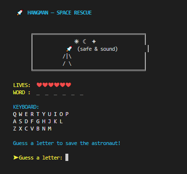
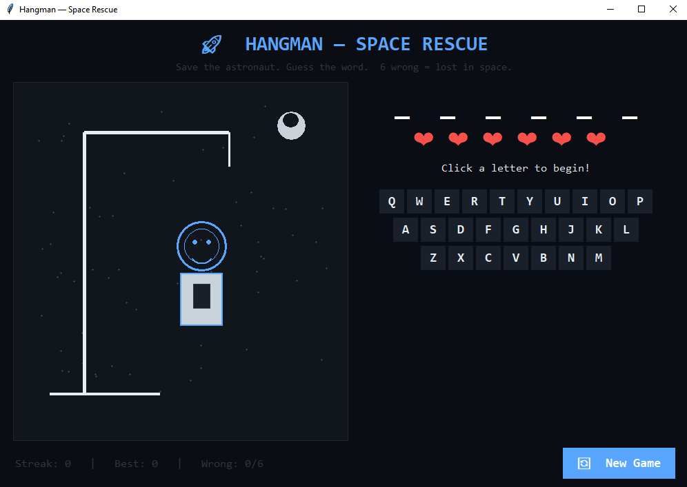
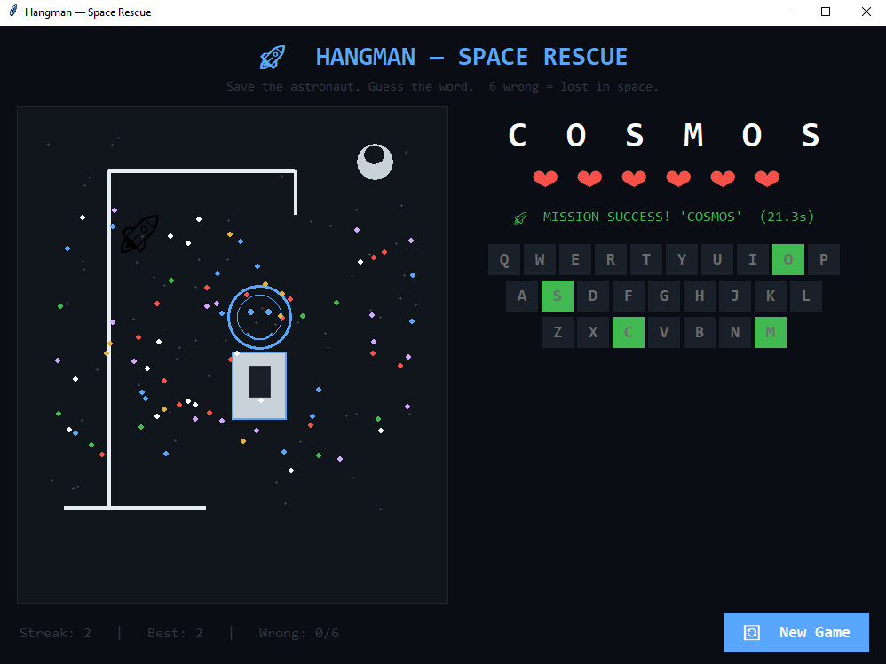

# 🚀 CodeAlpha_HangmanGame

<p align="center">
  
  
  
  
  
</p>

<p align="center">
  <b>A polished Hangman game — Space Rescue Edition — built for the CodeAlpha Python Programming Internship.</b><br>
  Two playable modes: a fully spec-compliant <b>console edition</b> and a bonus <b>graphical edition</b> with a live-drawn astronaut, animated confetti, screen shake, and sound.
</p>

---

## 📖 Table of Contents

- [👤 Intern Information](#-intern-information)
- [🎮 Overview](#-overview)
- [✨ Features](#-features)
- [🖼️ Screenshots](#️-screenshots)
- [🚀 How to Run](#-how-to-run)
- [📁 Project Structure](#-project-structure)
- [📋 Task Requirements → Implementation](#-task-requirements--implementation)
- [🧠 Concepts Demonstrated](#-concepts-demonstrated)
- [🔍 Code Highlights](#-code-highlights)
- [🛠️ Troubleshooting](#️-troubleshooting)
- [📚 What I Learned](#-what-i-learned)
- [👨‍💻 Author](#-author)
- [📄 License](#-license)

---

## 👤 Intern Information

| Field | Detail |
|-------|--------|
| **Name** | Nyamedor Oswald Ayiku |
| **Student ID** | CA/DF1/322006 |
| **Domain** | Python Programming |
| **Batch** | 20 Oct 2026 – 20 Nov 2026 |
| **Task** | Task 1 — Hangman Game |
| **Submission Deadline** | 20 Nov 2026 |

---

## 🎮 Overview

This project was built as **Task 1** of the CodeAlpha Python Programming Internship. The goal was a simple text-based Hangman game — but I took the brief further by delivering:

1. **A fully spec-compliant console game** — exactly 5 predefined words, 6 wrong guesses max, basic console I/O, using `random`, `while`, `if-else`, strings, and lists.
2. **A bonus graphical edition** — a real `tkinter` window with a live-drawn astronaut, animated feedback, and sound effects.

Both modes share the same game logic, word bank, and rules — only the presentation differs.

### Why two modes?

The CodeAlpha task spec says: *"Basic console input/output — no graphics or audio."*

To stay **100% compliant**, the default `python hangman.py` runs the console edition. The graphical edition is **opt-in** via `--gui` — a bonus that demonstrates additional skills without breaking the spec.

---

## ✨ Features

### Console Edition (Official / Spec-Compliant)

| Feature | Description |
|---------|-------------|
| 🎨 **Colorized terminal UI** | ANSI colors on Windows, macOS, and Linux |
| ⌨️ **On-screen QWERTY keyboard** | Green = correct, red = wrong, dim = unused |
| ❤️ **Heart lives counter** | `❤ ❤ ❤ ❤ ♡ ♡` — visual lives at a glance |
| 🚀 **6-stage rocket art** | Rocket degrades with each wrong guess |
| 📊 **Streak tracking** | Current streak, best streak, rounds played |
| ✅ **Full input validation** | Rejects repeats, non-letters, multi-char inputs |
| 🔁 **Play again loop** | New word every round |

### Graphical Edition (Bonus)

| Feature | Description |
|---------|-------------|
| 🪟 **Real tkinter window** | 1000×720 dark-themed window |
| 👨‍🚀 **Live-drawn astronaut** | Helmet → body → arms → legs appear per wrong guess |
| 🌌 **Starfield + moon** | Random stars drawn on the canvas |
| 🖱️ **Clickable keyboard** | No typing — click letters to play |
| 🎯 **Hover effects** | Buttons light up on mouse-over |
| 💥 **Screen shake** | Window jolts on wrong guesses |
| 🎉 **Confetti animation** | Colored particles fall on a win |
| 🚀 **Rocket launch animation** | Rocket flies up the canvas on a win |
| 🔊 **Sound effects** | Beeps on Windows via `winsound` (silent fallback on Mac/Linux) |
| ⏱️ **Live round timer** | Tracks how long each round takes |
| 🔄 **New Game button** | Resets state instantly |

---

## 🖼️ Screenshots

### Console Edition


*Colorized terminal with keyboard, hearts, and rocket art.*

### Graphical Edition — Gameplay


*Astronaut gains body parts per wrong guess.*

### Graphical Edition — Victory


*Confetti + rocket launch on a win.*

---

## 🚀 How to Run

### Prerequisites

- **Python 3.8+** (check with `python --version`)
- No external packages needed — **pure standard library**

### 1. Clone the repo

```bash
git clone https://github.com/Oswald179/CodeAlpha_HangmanGame.git
cd CodeAlpha_HangmanGame
```

### 2. Run the console edition (official)

```bash
python hangman.py
```

### 3. Run the graphical edition (bonus)

```bash
python hangman.py --gui
```

> **Linux users:** If `tkinter` is missing, install it once:
> ```bash
> sudo apt install python3-tk     # Debian/Ubuntu
> sudo dnf install python3-tkinter # Fedora
> ```

---

## 📁 Project Structure

```
CodeAlpha_HangmanGame/
│
├── hangman.py            ← ENTRY POINT — routes to console or GUI
├── hangman_console.py    ← Console edition (spec-compliant)
├── hangman_gui.py        ← Graphical edition (bonus)
├── README.md             ← You are here
│
└── screenshots/
    ├── console-gameplay.png
    ├── gui-gameplay.png
    └── gui-win.png
```

### Entry point routing

`hangman.py` checks `sys.argv` for `--gui`:
- **Without flag** → imports and runs `hangman_console.main()`
- **With flag** → imports and runs `hangman_gui.main()`

This keeps the spec-compliant version as the default path.

---

## 📋 Task Requirements → Implementation

Every requirement from the CodeAlpha task PDF is explicitly met:

| # | Requirement (from task PDF) | Status | Where |
|---|------------------------------|--------|-------|
| 1 | Small list of **5 predefined words** | ✅ | `WORDS = ["planet", "rocket", "galaxy", "meteor", "cosmos"]` |
| 2 | Limit incorrect guesses to **6** | ✅ | `MAX_WRONG = 6` in both modules |
| 3 | **Basic console I/O — no graphics or audio** | ✅ | `hangman_console.py` — only `print()` + `input()` |
| 4 | Uses **`random`** | ✅ | `random.choice(WORDS)` |
| 5 | Uses **`while`** | ✅ | Main game loop: `while wrong < MAX_WRONG` |
| 6 | Uses **`if-else`** | ✅ | Input validation + win/loss checks |
| 7 | Uses **strings** | ✅ | Word masking, message formatting |
| 8 | Uses **lists** | ✅ | `guessed = []` tracks letters; `WORDS` is a list |

> The graphical edition is a **bonus feature** — it does not replace the console edition, which remains the official spec-compliant submission.

---

## 🧠 Concepts Demonstrated

### Python Fundamentals
- `random` module — word selection
- `while` loops — game loop
- `if / elif / else` — validation and win/loss logic
- Strings — masking, formatting, ANSI codes
- Lists — tracking guessed letters
- Functions — `play_round()`, `render_screen()`, `get_reply()`
- Dictionaries — `letter_buttons` mapping in GUI

### Intermediate
- **ANSI escape codes** — colored terminal output
- **Modular design** — separate modules for console and GUI
- **`sys.argv` parsing** — flag-based routing (`--gui`)
- **Cross-platform detection** — `os.name == "nt"` for Windows

### GUI (Bonus)
- **`tkinter` widgets** — Labels, Buttons, Frames, Canvas
- **Canvas drawing** — `create_oval`, `create_line`, `create_rectangle`, `create_arc`
- **Event binding** — `<Enter>`, `<Leave>`, `command=`
- **Animation** — `after()` callbacks for shake, confetti, rocket
- **Hover state** — button background changes on mouse-over

### Robustness
- **Input validation** — rejects repeats, non-letters, multi-char
- **Graceful fallback** — sound silently skips on non-Windows
- **Error handling** — `try/except ImportError` for tkinter and winsound

---

## 🔍 Code Highlights

### 1. Word masking with color (console)

```python
def render_word(word, guessed):
    return "  ".join(
        f"{C.GREEN}{C.BOLD}{c.upper()}{C.RESET}" if c in guessed
        else f"{C.DIM}_{C.RESET}" for c in word)
```

### 2. On-screen keyboard state (console)

```python
def render_keyboard(guessed, word):
    rows = ["QWERTYUIOP", "ASDFGHJKL", "ZXCVBNM"]
    out = []
    for row in rows:
        line = []
        for letter in row:
            low = letter.lower()
            if low in guessed:
                line.append(f"{C.GREEN}{letter}{C.RESET}" if low in word
                            else f"{C.RED}{letter}{C.RESET}")
            else:
                line.append(f"{C.WHITE}{letter}{C.RESET}")
        out.append("  " + " ".join(line))
    return "\n".join(out)
```

### 3. Live astronaut drawing (GUI)

```python
# Each wrong guess adds a body part
if self.wrong >= 1:
    c.create_oval(265, 115, 335, 185, outline=HELMET, width=3)  # helmet
if self.wrong >= 2:
    c.create_rectangle(268, 185, 332, 300, fill=SUIT)           # body
if self.wrong >= 3:
    c.create_line(268, 210, 220, 250, fill=SUIT, width=8)       # left arm
# ... and so on for arms and legs
```

### 4. Screen shake animation (GUI)

```python
def _shake(self):
    x = self.root.winfo_x()
    y = self.root.winfo_y()
    offsets = [(-6, 0), (6, 0), (-4, 2), (4, -2), (0, 0)]
    def step(i=0):
        if i < len(offsets):
            dx, dy = offsets[i]
            self.root.geometry(f"+{x+dx}+{y+dy}")
            self.shake_job = self.root.after(30, step, i + 1)
    step()
```

### 5. Entry-point routing

```python
if __name__ == "__main__":
    if "--gui" in sys.argv:
        from hangman_gui import main as gui_main
        gui_main()
    else:
        from hangman_console import main as console_main
        console_main()
```

---

## 🛠️ Troubleshooting

### `ModuleNotFoundError: No module named 'tkinter'`

**Linux users only.** tkinter is bundled with Python on Windows and macOS but sometimes missing on Linux.

```bash
sudo apt install python3-tk        # Debian/Ubuntu
sudo dnf install python3-tkinter   # Fedora
sudo pacman -S tk                  # Arch
```

### Colors show as `[91m` or `[1m` in the terminal

Your terminal doesn't support ANSI codes. Try:
- **Windows:** Use Windows Terminal, PowerShell 7, or CMD on Windows 10+
- **macOS/Linux:** Use any modern terminal (iTerm2, GNOME Terminal, etc.)

### No sound in the GUI

Sound uses `winsound`, which is **Windows-only**. On macOS/Linux, the game silently skips sound and plays normally.

### Window opens but is too small

Try maximizing the window or edit `root.geometry("1000x720")` in `hangman_gui.py`.

### `--gui` flag not recognized

Make sure you're running from the project root:

```bash
cd CodeAlpha_HangmanGame
python hangman.py --gui
```

---

## 📚 What I Learned

This project reinforced:

- **Clean separation of concerns** — game logic vs. presentation
- **Modular design** — one entry point, two implementations
- **Cross-platform thinking** — ANSI support, sound fallback, tkinter availability
- **User experience** — visual feedback (hearts, colors, screen shake) makes a simple game feel polished
- **Specification discipline** — the console edition strictly meets the PDF requirements; the GUI is a respectful bonus

---

## 👨‍💻 Author

**Nyamedor Oswald Ayiku**

- 🎓 CodeAlpha Python Programming Intern
- 🪪 Student ID: `CA/DF1/322006`
- 📅 Batch: 20 Oct 2026 – 20 Nov 2026
- 💼 [LinkedIn](https://www.linkedin.com/in/oswald-nyamedor-297441256)
- 🐙 [GitHub](https://github.com/Oswald179)

---

## 🙏 Acknowledgments

- **CodeAlpha** for the internship opportunity and clear task specification
- The Python community for excellent standard library documentation

---

## 📄 License

This project was created for the **CodeAlpha Internship Program**.
Free to use for educational purposes.

<p align="center">
  <i>Built with 🐍 Python — Console + GUI, one repo.</i>
</p>